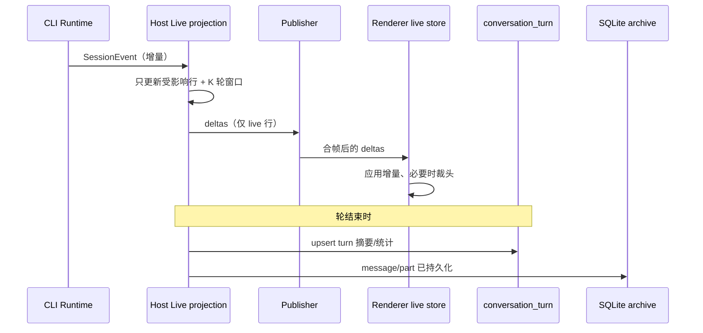
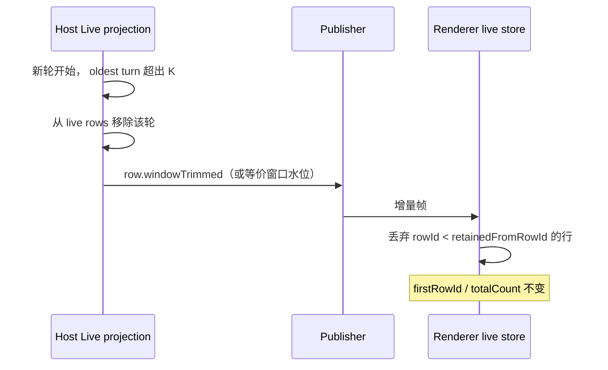
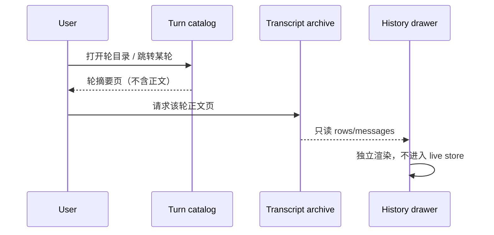

# 会话实时视图与历史归档分层

- 状态：Draft
- 日期：2026-10-26
- 范围：V4 conversation projection、协议、持久化派生索引、Renderer 渲染管线
- 关联文档：
  - `docs/performance/conversation-row-structural-sharing.md`
  - `docs/performance/ui-render-stability.md`
  - `docs/performance/v4-conversation-cold-hydration.md`

## 1. 背景

长会话会随着内容增长持续变卡。这不是模型上下文缓存或 compaction 的问题：compaction 只裁剪 provider 上下文，SQLite 与 UI 时间线仍保留全量历史。根因是**全量历史同时进入了实时投影、每帧渲染和冷启动路径**。

现有链路：

```
SessionEvent
  → ProductProjection（Host，保留全量 rows.window）
  → 30/150ms 合帧
  → ConversationProjectionStore（Renderer，rows.window 随 append/loadOlder 单调增长）
  → SessionPane（订阅整个 store state）
  → ConversationTimeline（每帧重建全部 render units）
  → 可见 ConversationTurnGroup / ConversationRowView
```

### 1.1 已确认的随历史增长的成本

> 行号基于 2026-10-26 的工作区状态；文件后续改动时以符号名为准。

| 位置                                                                                            | 成本                                                                             |
| ----------------------------------------------------------------------------------------------- | -------------------------------------------------------------------------------- |
| `packages/shared/src/zcode-protocol-v4/apply.ts:77-128`                                         | 每个 delta `findIndex` + 复制整个 window                                         |
| `packages/ui/src/v4/conversationProjectionStore.ts:804-829`                                     | 每帧全窗口结构共享扫描                                                           |
| `packages/ui/src/v4/useConversationProjection.ts:19-26`、`SessionPane.tsx:738`                  | 订阅整个 store state，无 selector                                                |
| `SessionPane.tsx:810-827`                                                                       | 分享 render units / items 无条件构建；`conversationShareItems.ts:13-32` 为 O(T²) |
| `SessionPane.tsx:2605-2632`、`:2977`、`:3101-3108`                                              | 四张 workflow 联查表随窗口重建，击穿 `rowContext` 与行级 memo                    |
| `ConversationTimeline.tsx:448, 466-478`                                                         | 每帧全量 render unit 构建；`:679-687` 每秒 tick 也触发一次                       |
| `ConversationTurnGroup.tsx:480`                                                                 | 一个 turn 的全部 work rows 一次性渲染，无 turn 内虚拟化                          |
| `message.tsx:1334-1347`                                                                         | 流式 markdown 每个 chunk 对全文跑预处理 + lex                                    |
| `apps/zcode-cli/packages/bootstrap/src/zcode-protocol-v4/product-projection.ts:1085, 1246-1370` | 每个事件全窗口复制、Map 重建、全行扫描与 `JSON.stringify`                        |
| `v4-bridge.ts:1650-1655`、`v4-gateway.ts:3107-3145`                                             | 冷启动读取全量 transcript，且 hydrate 两次                                       |
| `ConversationTimeline.tsx:731-764`、`conversationTurnNavigatorHelpers.ts:80-91`                 | 宽屏下 turn navigator 自动 `loadAllOlder()`，无需用户操作                        |

### 1.2 已有但不足的机制

- Host 侧 30/150ms 合帧（`packages/shared/src/zcode-protocol-v4/core.ts:34-59`）。
- 初始快照尾窗 60 行、`rows/range` 每页 200 行（`core.ts:75-76`）。
- Renderer 行对象结构共享（`conversationRowSharing.ts`）。
- 虚拟滚动 + 行高缓存（`ConversationTimeline.tsx:2065-2092`、`timelineRowHeightCache.ts`）。
- 这些机制只降低了单份数据的大小和 DOM 数量，没有让**每帧/每事件成本与总历史长度解耦**。

## 2. 产品规则

1. 主视图默认只保留并展开最近 **K 个产品轮**，K 默认 3，可配置为 1 / 3 / 5 / 全部。
2. 当前运行中的轮始终展开；最近的前 1–2 轮可折叠显示。
3. 更早的轮折叠为一行「更早的 N 轮」，点击进入**只读历史抽屉**。
4. 历史抽屉按轮分页加载，不参与流式更新，不计算 `canEdit` / `canRetry` / `canFork`。
5. 每轮 git 变更摘要（文件数、增删行）常驻；git 仍是 diff 的事实源，对话视图只做摘要和入口。
6. 保留策略只影响 Renderer 的 live 窗口和 Host 的 live projection，不影响：
   - SQLite 中的完整 transcript；
   - 模型上下文与 compaction；
   - 分享、导出、搜索的可用范围（这些走归档）。
7. 用户可以对任意历史轮执行「从这里继续 / 编辑」，该操作是 rewind 命令，不是把历史重新加载进 live 视图。

## 3. 三层数据平面

```
                 SQLite (~/.zcode/cli/db/db.sqlite)
                 message / part / turn_usage：全量事实源
                              │
        ┌─────────────────────┼─────────────────────────┐
        │                     │                         │
        ▼                     ▼                         ▼
  Live projection       Turn catalog              Transcript archive
  Host 内存，有界        派生索引，按轮一行         只读分页读取
  最近 K 轮 + 当前轮     标题/状态/耗时/文件统计      message/part 原文
        │                     │                         │
        │ 只发 live 行 delta   │ 目录页                   │ 归档页
        ▼                     ▼                         ▼
  Renderer live store   Navigator / Share /       History drawer
  有界 K 轮             Search / Jump / Git       只读时间线
        │
        ▼
  当前工作台视图（当前轮展开，前两轮可折叠）
```

### 3.1 Live projection

- 所有者：Host 的 per-session `ProductProjection` / publisher。
- 内容：最近 K 轮（按 `turnId` 分组）+ 当前运行轮，包含 actions、流式状态、queue、pending interactions 等实时字段。
- 生命周期：会话驻留期间常驻；轮次滑出 K 即从 rows 窗口淘汰；Host 重启后从 archive 重建。
- 规则：
  - 不保留全量历史 rows。
  - 事件处理只触碰受影响的行 + K 轮窗口。
  - 旧轮需要的文件变更、计划、耗时等事实来自 catalog 或已有 snapshot 字段，不从 rows 历史反推。

### 3.2 Turn catalog

- 所有者：持久化派生表（建议名 `conversation_turn`），可从 `message` / `part` / `turn_usage` 重建。
- 内容：每轮一行，供导航、分享选择、搜索、跳转、git 摘要使用。
- 生命周期：轮结束时写入/更新；rewind 后按 `branchGeneration` 失效并重建。
- 规则：
  - 是导航的唯一来源，Render 不再依赖已加载 rows 生成完整轮目录。
  - 不包含大段正文，只保留预览和统计；正文按需从 archive 读取。

### 3.3 Transcript archive

- 所有者：SQLite；Host 提供只读查询接口。
- 内容：`message` / `part` 原文，按 `sequence` 分页。
- 生命周期：无状态；每次查询按当前 active branch 过滤。
- 规则：
  - 只读，不生成 live rowId，不计算 actions，不参与流式。
  - 打开历史抽屉时才加载；关闭即释放，只保留小 LRU 页缓存。
  - 必须复用 `session.revert` 的 active branch 规则（`branchCutAfterMessageID`、`keptMessageIDs`、`branchGeneration`）。

## 4. 状态所有权与不变量

### 4.1 所有权

| 数据                                         | 唯一所有者                  | 其他层如何获得    |
| -------------------------------------------- | --------------------------- | ----------------- |
| 实时行、actions、queue、pending interactions | Host Live projection        | 增量帧            |
| 轮目录、预览、状态、耗时、文件统计           | `conversation_turn` catalog | 目录分页查询      |
| 完整正文、工具输出、附件引用                 | SQLite message/part         | archive 分页查询  |
| 当前视图保留轮数 K                           | Renderer/窗口设置           | subscribe 参数    |
| 历史抽屉的页码与滚动位置                     | 历史抽屉自身                | 不进入 live store |

### 4.2 不变量

1. `rows.window` 只包含最近 K 轮 + 当前轮；长度有界。
2. `firstRowId` 始终是 active branch 第一行；`window[0].rowId` 是已加载首行；`totalCount` 是 branch 总行数，仅用于滚动条估计。
3. 裁头只改变 `window`，不改变 `firstRowId` / `totalCount`；`hasOlderRows` 仍由 `window[0] > firstRowId` 判定。
4. 对未加载行的 `row.delta` / `row.upserted` 是 no-op（现有 `apply.ts` 语义）。
5. `row.removed.fromRowId` 落在已裁掉的头部时（`firstRowId < fromRowId <= window[0].rowId`），客户端不能本地计算新窗口，必须请求 snapshot recovery。
6. Catalog 是可重建派生数据，不能成为新的事实源。
7. Archive 读取必须与 active branch 一致；`logEpoch` 变化时作废所有游标。
8. Live 路径禁止任何 O(总历史) 的扫描、复制或序列化。
9. 运行中的轮只存在于 live projection，持久化完成后才进入 catalog/archive。

## 5. 事件与时序

### 5.1 实时事件



### 5.2 轮滑出 live 窗口



### 5.3 历史抽屉



## 6. 接口与协议变更

### 6.1 Conversation topic

- subscribe 增加可选的 `liveTurnLimit`（默认取服务端策略，建议 3）。
- 初始 snapshot 的 `rows.window` 只包含 live 窗口；保留 `firstRowId` / `totalCount` 语义。
- 新增 delta op：`row.windowTrimmed { retainedFromRowId }`，语义为丢弃 `rowId < retainedFromRowId` 的已加载行；不改变 `firstRowId` / `totalCount`。
- 当 `liveTurnLimit` 不同的客户端共存时，publisher 按订阅生成不同的 trim/窗口；live projection 本身保留所有订阅需要的最大 K。
- 断线恢复：
  - 若客户端 `seq` 仍在 retained log 内，发增量；
  - 否则发有界 snapshot（live 窗口），历史由 archive 游标补齐。

### 6.2 Archive RPC

| 方法                      | 用途          | 关键参数                                             |
| ------------------------- | ------------- | ---------------------------------------------------- |
| `conversation/turns`      | 轮目录分页    | `sessionId`, `beforeOrdinal`/`afterOrdinal`, `limit` |
| `conversation/transcript` | 只读正文分页  | `sessionId`, `beforeSequence`, `limit`, `turnId?`    |
| `conversation/search`     | 归档搜索      | `sessionId`, `query`, `cursor`                       |
| `conversation/turnDetail` | 单轮正文/统计 | `sessionId`, `turnId`                                |

所有方法：

- 只读，幂等；
- 返回 `logEpoch` / `branchGeneration`，客户端据此判断游标是否过期；
- 不返回 live actions。

### 6.3 兼容

- `liveTurnLimit` 与 `row.windowTrimmed` 均为 additive；旧 CLI 不发送时，Renderer 退化为当前全量窗口行为。
- 新 CLI + 旧 Renderer：Renderer 不识别 trim 时，按现有尾窗逻辑处理，不做裁头；不能破坏旧会话恢复。
- 协议版本升级后，旧客户端继续走有界 snapshot 兼容模式，直到迁移完成。

## 7. 持久化变更

### 7.1 `conversation_turn`（派生表）

```sql
CREATE TABLE conversation_turn (
  session_id TEXT NOT NULL REFERENCES session(id) ON DELETE CASCADE,
  turn_id TEXT NOT NULL,
  ordinal INTEGER NOT NULL,
  first_sequence INTEGER NOT NULL,
  last_sequence INTEGER NOT NULL,
  user_message_id TEXT,
  user_preview TEXT,
  assistant_preview TEXT,
  status TEXT NOT NULL CHECK (status IN ('running', 'completed', 'error', 'cancelled')),
  started_at INTEGER NOT NULL,
  completed_at INTEGER,
  model_id TEXT,
  input_tokens INTEGER NOT NULL DEFAULT 0,
  output_tokens INTEGER NOT NULL DEFAULT 0,
  file_count INTEGER NOT NULL DEFAULT 0,
  additions INTEGER NOT NULL DEFAULT 0,
  deletions INTEGER NOT NULL DEFAULT 0,
  branch_generation INTEGER NOT NULL DEFAULT 0,
  PRIMARY KEY (session_id, turn_id)
);

CREATE INDEX conversation_turn_session_ordinal_idx
  ON conversation_turn(session_id, ordinal);
```

- 写入时机：轮完成时由 Host 根据 projection + `turn_usage` + 已持久化 part 派生写入。
- 重建：可从 `message` / `part` / `turn_usage` 全量重建；重建期间 archive 仍可读。
- rewind：`branchGeneration` 变化时，按新分支重建受影响轮次，旧分支目录不展示。

### 7.2 归档搜索（可选第二阶段）

- 新增 FTS5 派生表（或先使用 `LIKE` + 索引），只索引 `message` / `part` 的可搜索文本，不索引工具大输出。
- 搜索结果返回 `turnId` + `sequence`，由 archive 拉取正文页。

### 7.3 分页查询

- `message` 已有 `(session_id, sequence)` 索引；`part` 已有 `(session_id, message_id, sequence)` 索引。
- Archive 查询只取 `limit + 1` 判断是否还有下一页，避免全表扫描。
- 需要新增的查询在 `SessionStorePort` 上提供分页签名，替换当前无分页的 `messages()` 依赖。

## 8. Host 侧改造

1. **有界 live projection**
   - 用环形窗口 / 可变累加器维护 K 轮；不再每个事件复制整个 `rows.window`。
   - `materializeCommandRowActions` 改成增量：
     - 维护 `latestAssistant`、`latestEditable`、`latestRetryable` 指针；
     - 只更新受影响行的 actions；
     - 不再对全部行 `JSON.stringify`。
2. **tail-first 冷启动**
   - 只读取最近 K 轮的 message/part 和 catalog 页，构建 live projection。
   - 不再调用无分页的 `messages()`；不再 hydrate 两次。
   - runtime resume / provider history 作为独立异步路径，不阻塞首屏。
3. **归档读取**
   - 新增 `conversation/turns`、`conversation/transcript`、`conversation/search` handler。
   - Archive 读取复用 active branch 过滤逻辑，不构建 live rowId。
4. **派生状态清点**
   - 逐项确认哪些状态必须留在 live：`queue`、`pendingInteractions`、`usage`、`plan`、`todo`、`goal`、`workflowRuns`、`subagents`、`modelTransition`。
   - 哪些应进 catalog：每轮文件统计、标题/预览、耗时、状态。
   - 哪些只在 archive：完整正文、工具输出、历史文件 diff。
5. **多端**
   - `desktop-continuous`：有界 live snapshot + 增量。
   - `web-remote-replayable`：有界 snapshot + `seq`；gap 超界时 resync。
   - 手机端不复用桌面全量窗口；按需打开 archive。

## 9. Renderer 侧改造

1. **有界 live store**
   - `rows.window` 由协议保证有界；Renderer 只做防御性上限，不自行无限前插。
   - `loadOlder` 不再把历史并入 live store；历史走独立抽屉。
2. **按轮缓存 render unit**
   - 以 turn 的行数组引用或版本号为 key 缓存 `buildConversationTurnRenderUnits` 的产物。
   - 只有当前运行轮失效重建；历史轮不参与每帧。
   - `liveNowMs` 不再进入 unit 身份，只传给运行中的轮。
3. **稳定 context**
   - 把 workflow 四张表从 `rowContext` 依赖中拆出，按功能拆 context。
   - 恢复 `ConversationRowView` 的 memo 命中；流式帧只重渲染当前轮。
4. **帧级合帧**
   - store 通知用 `requestAnimationFrame` / 20–30ms 合并。
   - 非紧急更新使用 `useDeferredValue` / `startTransition`。
5. **turn 内虚拟化**
   - 将超长轮拆成虚拟子单元，或给每个 work item 加 `content-visibility: auto`。
   - 已完成的工具调用默认折叠/分组；不要把 500 个工具行塞进一个虚拟项。
6. **历史抽屉**
   - 独立 store、独立只读 renderer，可复用 `ConversationShareReadonlyTimeline` 的思路。
   - 不计算 actions，不参与流式，不写入 live store。
7. **分享与搜索**
   - 分享选择从 catalog 取轮目录，正文按选中轮从 archive 拉取。
   - 搜索走 archive，不扫描 live rows。

## 10. 内容渲染管线

1. **增量 markdown**
   - 缓存已完成 block 的解析结果，只重算最后一个未闭合 block。
   - 对全文预处理（citation、图片归一、数学公式、artifact 路径）做内容 hash 缓存；追加时只处理新增片段。
2. **高亮 / Mermaid / diff**
   - Shiki、Mermaid、`@pierre/diffs` 移到 worker 或按需异步执行。
   - 完成态用 IntersectionObserver 按需开启，避免所有代码块同时高亮。
3. **工具卡**
   - `buildToolDisplayModel` / `readRawToolCallFileSummaries` 使用 content-addressed LRU（toolId + input/output hash）。
   - 适配器在 input/output 未变时保留对象身份，减少 memo 失效。
4. **有界缓存**
   - Shiki tokens、tool open state、workflow card open state 全部改为有界 LRU。
   - Mermaid 增加按源码 hash 的渲染缓存。

## 11. 性能合同与验收

### 11.1 预算

| 指标               | 目标                                                       |
| ------------------ | ---------------------------------------------------------- |
| 单次 live 事件处理 | O(受影响行 + K)，与总历史无关                              |
| 首屏可交互         | 只读 K 轮 + 一页 catalog；10,000 消息 fixture 目标 < 500ms |
| 流式帧             | 无 > 50ms 主线程长任务；可见历史轮不参与重渲染             |
| Heap               | 随轮数增长呈平台，不线性上涨                               |
| 历史抽屉打开       | 只拉一页 transcript；关闭后页缓存可释放                    |

### 11.2 验收场景

1. **10,000 轮 fixture**：冷启动、发送、流式、滚动到底、打开历史抽屉；帧耗时与 100 轮 fixture 无显著差异。
2. **单轮 500 个工具调用**：turn 内虚拟化生效，DOM 节点数与可见区域相关，不随工具数线性增长。
3. **单条 50k token 流式回答**：markdown 增量解析；完成态无高亮尖峰。
4. **rewind**：
   - 目标在 live 窗口内：本地应用；
   - 目标在已裁头区域：强制 snapshot recovery，窗口与 `totalCount` 正确；
   - rewind 后 catalog 按 `branchGeneration` 更新。
5. **分享**：从 catalog 选择历史轮，archive 拉取正文，不把历史并入 live store。
6. **搜索**：命中归档轮，跳转到只读历史抽屉。
7. **手机远控**：断线超过 retained log 后收到有界 snapshot，再从 archive 拉历史页。
8. **多窗口**：不同 `liveTurnLimit` 的两个窗口共存，各自窗口正确，Host 不因较大的 K 退化为全量。

### 11.3 回归门槛

- `pnpm typecheck`、`pnpm lint`、`pnpm architecture:check --changed`。
- 受影响的 store/protocol 单测必须先失败再修复。
- 桌面 E2E：长会话流式、滚动、rewind、分享、搜索、手机重连。
- 性能 fixture 纳入 CI 或至少 nightly，记录帧耗时、heap、首屏时间。

## 12. 迁移计划

按风险排序，范围不缩水：

1. **Spec 与观测**
   - 落地本 spec；补 10,000 轮 / 单轮 500 工具 / 50k token 回答 fixture。
   - 增加首屏、帧耗时、heap、`rows.window.length` 指标。
2. **Catalog + archive**
   - 新增 `conversation_turn` 与 archive RPC。
   - 把 turn navigator、分享选择、搜索迁到 catalog/archive。
   - 停掉宽屏自动 `loadAllOlder`；历史入口改为只读抽屉。
3. **Host 有界化**
   - live projection 改为 K 轮环形窗口。
   - 增量 action materialization。
   - tail-first 冷启动；去掉双重 hydrate。
4. **Renderer 管线**
   - 有界 store、按轮缓存、稳定 context、rAF 合帧、turn 内虚拟化。
5. **内容管线与缓存治理**
   - 增量 markdown、worker 高亮、content-hash LRU、有界缓存。
6. **移除全量路径**
   - 删除依赖全量 rows 的导航/分享/搜索派生逻辑。
   - 旧客户端走有界 snapshot 兼容模式，确认无回归后移除兼容分支。

每阶段都有 feature flag 和回滚路径；catalog 与 archive 是 additive，可先上线不影响旧链路。

### 12.1 上游同步与冲突成本

本仓库通过 `upstream`（`zai-org/ZCode`）同步官方源码：官方版本以单亲的 `chore: sync ZCode source` 整树提交进入 `main`，本地特性分支在其上 rebase。发布节奏大约 1–3 周一次（v3.14.3 2026-09-24 → v3.15.1 2026-10-10 → sync 2026-10-19/20）。最近一次 sync 改动 263 个文件（+10,549/−4,087），版本升级改动 4,502 个文件（+355,981/−121,976）。

当前本地分支只有 2 个提交、约 11 个文件条目、约 487 行新增，维护面很小。本 spec 的完整方案会显著扩大这个面：

| 阶段                                 | 估算代码量（含测试）  | 主要文件                                                                                                               | 上游冲突风险 |
| ------------------------------------ | --------------------- | ---------------------------------------------------------------------------------------------------------------------- | ------------ |
| P1 Renderer 保留窗口（可只做客户端） | 500–800 行            | `conversationProjectionStore.ts`、`ConversationTimeline.tsx`、导航 helper、少量 `SessionPane.tsx`、测试                | 中           |
| P2 Catalog + archive                 | 1,200–2,000 行        | 新 migration、catalog repository、archive reader、history drawer、gateway 注册点                                       | 低–中        |
| P3 Host 有界化 + 增量 + tail-first   | 1,500–2,500 行        | `product-projection.ts`、`conversation-topic-publisher.ts`、`v4-gateway.ts`、`v4-bridge.ts`、`transcript-hydration.ts` | 高           |
| P4 Renderer 管线 + turn 内虚拟化     | 800–1,500 行          | `SessionPane.tsx`、`ConversationTimeline.tsx`、`ConversationTurnGroup.tsx`、`ConversationRowView.tsx`                  | 高           |
| P5 内容管线与缓存治理                | 500–1,000 行          | `message.tsx`、`code-block.tsx`、`mermaid-block.tsx`、`shikiHighlighter.ts`、`ToolCallBlocks.tsx`                      | 中           |
| **合计**                             | **约 4,500–7,800 行** | **30–50 个文件，其中 8–12 个上游热点文件**                                                                             | **中–高**    |

冲突为什么集中在这几个文件：

| 文件                                                                                      | 当前行数 | v3.15.1 升级改动 | 最近一次 sync 改动 |
| ----------------------------------------------------------------------------------------- | -------: | ---------------: | -----------------: |
| `packages/ui/src/v4/SessionPane.tsx`                                                      |    6,305 |        +796/−608 |            +83/−12 |
| `packages/ui/src/v4/ConversationTimeline.tsx`                                             |    2,207 |           +2/−11 |            +101/−7 |
| `packages/ui/src/v4/ConversationTurnGroup.tsx`                                            |    1,718 |         +19/−122 |                  0 |
| `packages/ui/src/v4/ConversationRowView.tsx`                                              |    2,398 |            +2/−2 |                  0 |
| `apps/zcode-cli/packages/bootstrap/src/zcode-protocol-v4/product-projection.ts`           |    5,951 |           +49/−1 |                  0 |
| `apps/zcode-cli/packages/bootstrap/src/zcode-protocol-v4/conversation-topic-publisher.ts` |    1,222 |           +51/−2 |                  0 |
| `apps/zcode-cli/packages/bootstrap/src/zcode-protocol-v4/v4-gateway.ts`                   |    3,762 |         +286/−18 |                  0 |
| `packages/ui/src/v4/conversationProjectionStore.ts`                                       |    1,454 |           +16/−5 |                  0 |

这些文件体量大、上游每次发布都在改；在其中做上千行本地改造，几乎每次 sync 都会产生冲突。相反，新增文件（catalog repository、archive reader、history drawer、独立测试）不会冲突；冲突只集中在“接线点”和迁移注册表。

降低冲突的做法：

1. **上游优先**：P3/P4 是核心链路改造，最合理的归属是官方。若官方接受，本地分歧趋近于零；否则每次 sync 都要手工解 6 个左右核心文件的冲突。
2. **新增文件优先**：history drawer、catalog repository、archive reader、retention wrapper 都放新文件；对 `SessionPane` / `ConversationTimeline` 只做 1–2 处 feature flag 接线，不重写内部。
3. **手术式 diff**：不在热点文件里改名、移动、重排或格式化；每个关注点一个 commit，便于 rebase 时单独 drop/reapply；每次官方 sync 后立即 rebase，不要攒。
4. **迁移编号**：使用下一个 `00XX`，但准备在官方新增同号迁移时重编号；不修改旧 migration 的 checksum；派生表必须可重建。
5. **i18n**：新增文案尽量集中到新的 namespace/文件；否则要接受 8k 行 locale 文件的中等冲突风险。
6. **架构策略**：修改上游文件需要在 `architecture-policy.yaml` 增加 module/admission 条目，和代码 patch 放在同一个 commit；否则 `architecture:check` 会失败。
7. **测试**：新增测试放新文件；避免编辑上游测试文件。
8. **分歧预算**：如果热点文件本地 diff 超过约 2,000 行或涉及 4 个以上热点文件，应停下来评估上游化，而不是继续在 fork 里维护。

结论：

- **架构上最佳**是完整的三层方案。
- **fork 维护上最佳**是先做 P1（纯 Renderer 保留窗口，不碰协议和 DB），再做 P2（catalog/archive，新增文件为主）；P3/P4 优先提交官方。若官方不接受，接受 Host 侧仍为 O(总历史)，或只保留一个薄的 wrapper，不要把 3–4k 行核心改造长期背在本地分支上。
- 对你的实际症状（对话越长越卡）而言，P1 就能消掉大部分 Renderer 卡顿；P2 负责把导航/分享/搜索从全量 rows 上摘下来；P3 才决定极长会话的 Host 事件成本和冷启动。

## 13. 风险与待定

1. **派生状态清点**：`buildSessionPlansModel`、file change summaries、subagent/workflow 相关派生当前从 rows 历史读取，需要确认哪些改为 catalog、哪些保留在 snapshot。
2. **旧客户端兼容**：旧 Renderer 不认识 `row.windowTrimmed`，需要保持其现有尾窗行为；协议升级窗口期要明确。
3. **Catalog 重建成本**：10k 轮重建需要分批、可恢复；rewind 的 `branchGeneration` 失效范围要精确。
4. **搜索索引**：FTS5 是否进入第一阶段；若不进，先用 `LIKE` + 分页，避免阻塞主链路。
5. **多窗口 K 差异**：Host live projection 需要保留所有订阅的最大 K；极端情况下仍应设硬上限（例如 20 轮），超出走 archive。
6. **历史轮操作**：历史抽屉默认只读；「从这里继续 / 编辑」必须走 rewind 命令，并在目标前重建 live 窗口。
7. **用户体验**：折叠/展开的默认值、K 的设置入口、git 摘要的展示位置需要产品确认。

## 14. 非目标

- 不做「只在客户端裁窗口」的补丁；Host 每事件成本、冷启动和超长单轮仍在增长。
- 不把 UI 的 row 模型持久化成归档；归档读 message/part + catalog，避免 schema 与 UI 耦合。
- 不移除历史、不改变 compaction、不改变 provider 上下文。
- 不靠继续给全量历史加 memo/缓存；窗口无界时缓存只会推迟问题。
- 不要求一次性重写所有消费者；catalog/archive 先 additive 上线，再逐步迁移。

## 15. 实施状态（2026-10-26）

已落地并验证：

- **Renderer live 保留**：`ConversationProjectionStore` 支持 `setLiveTurnLimit` / `setViewFollowing`，跟随时只保留最近 K 个产品轮；`firstRowId` / `totalCount` 保持不变；rewind 目标落在已裁掉头部时强制 snapshot 重订阅（`conversationLiveRetention.ts`、`conversationProjectionStore.ts`）。
- **停止自动全量**：`ConversationTimeline` 新增 `disableTurnNavigatorAutoHydration`，主视图不再在宽屏下自动 `loadAllOlder()`。
- **历史只读抽屉**：legacy `session/messages` 新增 `beforeMessageId` 向后分页；新增 `useConversationHistory` 与 `ConversationHistoryDrawer`，历史不进入 live projection。
- **Host 流式成本**：纯 `row.delta` 事件不再触发 `materializeCommandRowActions` 的全窗口 Map/扫描/`JSON.stringify`（`product-projection.ts`）。
- **渲染稳定性**：workflow 联查表改为按 `workflowRowsRevision` 重建；历史轮 materialize 结果按行引用缓存；主会话开启 rAF 合帧（`conversationTurnRenderUnits.ts`、`SessionPane.tsx`、`conversationProjectionStore.ts`）。
- **内容管线**：流式 markdown 的解析输入按 50ms 合帧；Shiki token 缓存改为有界 LRU + 完整内容 hash（`message.tsx`、`shikiHighlighter.ts`）。

验证结果：

- `tsc -b`（shared / services / ui / web / desktop main+host）通过。
- `oxlint` 对改动文件 0 warning / 0 error。
- 单测：UI 225 个、Host projection 234 个、shared protocol + session service 101 个通过。
- 新文件 `oxfmt --check` 通过；既有文件存在仓库原有的格式漂移，未做整文件重排以避免放大上游 diff。

尚未落地（依赖归档层或大规模 Host 改造，未在未验证状态下硬改）：

- `conversation_turn` catalog 与 `conversation/turns` / `conversation/transcript` / `conversation/search` RPC。
- Host live projection 有界环形窗口、tail-first 冷启动、双重 hydrate 消除。
- turn 内虚拟化。
- 工具卡 content-addressed LRU 与 highlight/Mermaid worker 化。
- 导航/分享/搜索完全迁到 catalog/archive（当前历史抽屉已可用，导航仍只列已加载轮）。
